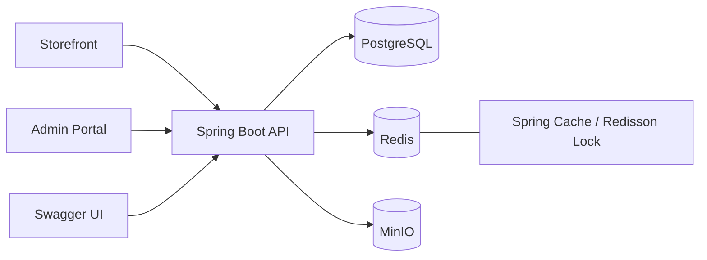
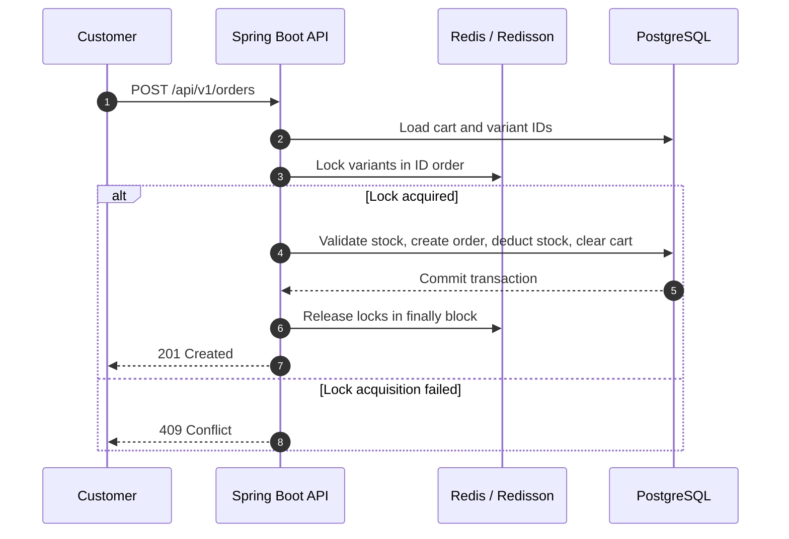
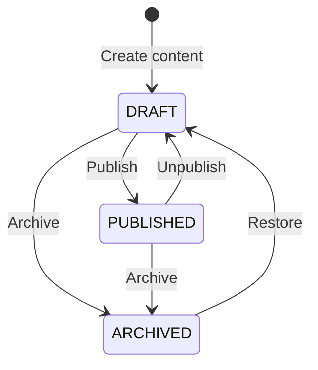

# 🎮 Gaming Gear

> A full-stack e-commerce platform for gaming gear. The repository contains a Spring Boot API, a React storefront for customers, and a separate React admin portal for system administration.

## ✨ Features

* **Authentication & authorization:** Registration, login, token refresh, logout, and role-based authorization with `CUSTOMER` / `ADMIN` using JWT.
* **Catalog:** Manage categories, brands, products, variants, and images. Product listing supports search, filtering, pagination, and sorting.
* **Cart & order:** Add, update, and remove cart items, COD checkout, order history, order cancellation, and order status management.
* **Redis cache:** Caches categories, brands, product lists/details, and CMS data. Related cache entries are invalidated whenever the underlying data changes.
* **Redisson lock:** Protects inventory during checkout, order cancellation, and variant updates, reducing the risk of overselling and lost updates.
* **MinIO:** Stores images for products, banners, and articles. The database stores only the corresponding `objectKey`.
* **CMS:** Manage banners, static pages, and articles with the lifecycle states `DRAFT`, `PUBLISHED`, and `ARCHIVED`.
* **Storefront & admin portal:** Separate React/Vite applications for customer shopping flows and admin catalog, order, and CMS management.
* **Rate limiting:** Redis-backed fixed-window limits protect login, registration, refresh-token, and upload endpoints.
* **API documentation:** Swagger UI provides API documentation and an interactive environment for testing endpoints directly.

## 🧰 Tech Stack

| Category             | Technology                                        |
| -------------------- | ------------------------------------------------- |
| Backend              | Java 21, Spring Boot 4.1.0, Gradle                |
| Frontend             | React 19, TypeScript, Vite, React Router, Axios   |
| Database             | PostgreSQL 17, Spring Data JPA, Hibernate, Flyway |
| Security             | Spring Security, JJWT, BCrypt                     |
| Cache & concurrency  | Redis 7, Spring Cache, Redisson 4.7.0             |
| Object storage       | MinIO 9.0.1                                       |
| API documentation    | springdoc-openapi / Swagger UI                    |
| Supporting libraries | Lombok, MapStruct                                 |
| Local infrastructure | Docker Compose                                    |

## 🏗️ High-Level Architecture



## 🔒 Checkout and Inventory Flow



Locks are acquired in a fixed order to reduce the risk of deadlocks. Every acquired lock is released in a `finally` block.

## 📝 CMS Content Lifecycle



This lifecycle is shared by banners, static pages, and articles. Public APIs only return content with the `PUBLISHED` status.

## 🚀 Running the Project

### Requirements

* JDK 21
* Docker Desktop
* Git

PostgreSQL, Redis, and MinIO are provided through Docker Compose, so you do not need to install these services directly on the host machine.

### 1. Configure the Environment

Create a `.env` file from the provided example:

```powershell
Copy-Item .env.example .env
```

The main environment variables include `POSTGRES_*`, `JWT_SECRET_BASE64`, `REDIS_*`, and `MINIO_*`.

The `.env` file contains local configuration and must not be committed to version control.

### 2. Start the Entire Stack with Docker Compose

```powershell
docker compose up --build -d
docker compose ps
```

| Service          | Local Address                               |
| ---------------- | ------------------------------------------- |
| Storefront       | http://localhost:5173                       |
| Admin Portal     | http://localhost:5174                       |
| API / Swagger UI | http://localhost:8080/swagger-ui/index.html |
| OpenAPI JSON     | http://localhost:8080/v3/api-docs           |
| MinIO Console    | http://localhost:9001                       |
| PostgreSQL       | `localhost:5436`                            |
| Redis            | `localhost:6380`                            |

View API logs:

```powershell
docker compose logs -f api_gaming
```

> Stop `bootRun` before starting Docker Compose because both use port `8080`.

### Run the API Locally with Infrastructure in Docker

```powershell
docker compose up -d postgres_gaming redis_gaming minio_gaming
.\gradlew.bat bootRun
```

Verify the build:

```powershell
.\gradlew.bat build
```

### Run the Frontend Locally

Open a second terminal from the project root:

```powershell
Set-Location frontend
npm ci
npm run dev:storefront
```

Open Storefront at http://localhost:5173. To start the Admin Portal instead, run:

```powershell
npm run dev:admin
```

Open Admin Portal at http://localhost:5174. Both Vite applications proxy `/api` to the backend at `http://localhost:8080` during local development.

## 📚 Swagger and Authorization

Swagger UI: http://localhost:8080/swagger-ui/index.html

Authentication flow in Swagger:

1. Call `POST /api/v1/auth/login` to obtain an `accessToken`.
2. Click **Authorize** and paste the access token.
3. Swagger automatically adds the `Bearer` prefix to requests that require authentication.

All endpoints under `/api/v1/admin/**` require the `ADMIN` role.

## 🗂️ Source Structure

```text
frontend/
├── apps/storefront/  # Storefront entrypoint
├── apps/admin/       # Admin Portal entrypoint
└── src/              # Shared API client, types, components, and pages
```

Backend source:

```text
src/main/java/com/tuanviet/gaminggear
├── common/       # Shared ApiResponse
├── config/       # Security, Redis, Redisson, MinIO, Swagger
├── controller/   # REST endpoints
├── dto/          # Request and response DTOs
├── entity/       # JPA entities
├── exception/    # Custom exceptions and GlobalExceptionHandler
├── mapper/       # Entity <-> DTO mapping
├── repository/   # Spring Data JPA repositories
├── security/     # JWT filter and UserDetails
└── service/      # Business logic
```

## 🌱 Demo Data

The `scripts/seed_demo_catalog.sql` script generates demo data including 5 categories, 12 brands, 330 products, 339 variants, and two test accounts.

> Warning: This script is intended for local development only. It deletes existing business data, including users, carts, orders, catalog data, and CMS content. The `roles` table and Flyway migration history are preserved. Running it replaces existing users with the two demo accounts below.

After the Docker containers have started, run the following command from the project root:

```powershell
[Console]::OutputEncoding = [System.Text.UTF8Encoding]::new($false)
Get-Content -Raw scripts/seed_demo_catalog.sql |
  docker compose exec -T postgres_gaming sh -c 'psql -v ON_ERROR_STOP=1 -U "$POSTGRES_USER" -d "$POSTGRES_DB"'
```

Product model names are based on publicly available catalogs from GEARVN. Prices, inventory quantities, and descriptions are demo data.

The script does not download or copy images from third-party sources.

### Demo Accounts

After running the seed script, use these accounts in Swagger UI or the frontend:

| Role | Email | Password |
| --- | --- | --- |
| `CUSTOMER` | `user@gmail.com` | `123456789` |
| `ADMIN` | `admin@gmail.com` | `123456789` |

The passwords are stored as BCrypt hashes in the SQL script. These accounts are for local demo purposes only and must not be used in a production environment.

## 🧹 Stop or Reset the Docker Environment

```powershell
# Stop containers while preserving PostgreSQL data and MinIO files
docker compose down

# Remove all local PostgreSQL and MinIO volume data
docker compose down -v
```
